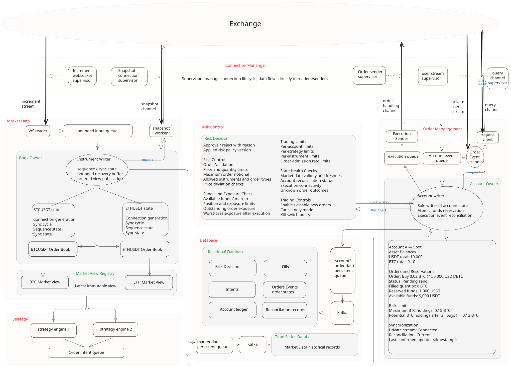

# Architecture

Keep one crate while the two Binance product connectors and shared book are being
built. Separate product modules provide independent contribution areas.
Introduce workspace crates only when independent dependencies, publishing, or build
isolation justify them.

## System Context

The diagram below describes a proposed trading-system context around Strait.
Only the public market-data portion belongs to the current repository scope;
strategies, OMS, private account streams, order execution, risk control, Kafka,
and databases are external integration concepts, not implemented capabilities or
additional roadmap commitments. The initial Binance Spot / USD-M scope remains
unchanged; see the [roadmap](roadmap.md) and [implemented Spot core](spot-sbe.md).

[](architecture.svg)

[Open the full-size diagram](architecture.svg).

Boxes represent logical responsibilities, not necessarily separate tasks, queues,
threads, or crates. Solid arrows represent data flow or calls; dotted supervisor
arrows represent lifecycle management. Failure/recovery flows and persistence
workers are omitted from this overview; the existing engineering and connection
contracts still apply. The diagram does not establish latency or readiness evidence.

### Market Data Ownership and Publication

- Each instrument has exactly one logical writer owning its mutable L2 book,
  sequence state, synchronization cycle, and bounded recovery buffer. A writer
  may own several instruments while preserving independent state and bounded,
  fair processing work per instrument.
- Readers deliver increments through a bounded input queue. Snapshot workers
  perform product-specific I/O outside the writer and return owned or lifetime-safe
  results tagged with connection generation and synchronization cycle. Only the
  writer validates alignment, installs snapshots, replays buffered increments,
  and publishes the resulting view. A separate snapshot-result channel or a
  per-request result is sufficient; no accumulating snapshot queue is implied.
- Connection generation identifies the source connection; synchronization cycle
  identifies an instrument rebuild. Neither replaces product-specific sequence
  validation. Connection lifecycle belongs to its supervisor.
- The Market View Registry maps full instrument identities to subscription handles.
  Strategies resolve handles during setup and observe independently; normal updates
  do not require central registry forwarding. Writers remain the sole publishers.
  Latest immutable views may skip intermediate versions for slow consumers, while
  book-building increments must never be silently dropped. Views carry instrument,
  cycle, version, validity, freshness, and timing metadata; consumers check age at use.

### Connections

Connection Manager denotes a logical connection-management subsystem. Individual
supervisors own actual connection lifecycles; readers and senders exchange data
directly with the venue rather than through a central forwarding task. Shared
management coordinates registry, admission, subscription and request budgets, and
shutdown. A multiplexed socket has one lifecycle owner, not one supervisor per
symbol or business arrow. Snapshot/query HTTP clients may instead use bounded
connection pools and request scheduling. Initial Spot snapshots use a separate
WebSocket API SBE session; USD-M snapshots use REST.

The diagram's query request/result arrows describe a logical API operation.
A request client may receive responses itself or share a response reader/handler;
request correlation and a single serialized outbound path must be explicit.
Detailed lifecycle, generation isolation, and aggregate capacity requirements live
in the [connection contract](connections.md).

### External OMS, Risk, and Persistence

These responsibilities explain the surrounding system, without prescribing new
Strait modules or dependencies:

- Strategies submit account-routed order intents. An intent can carry strategy
  instance, code/configuration version, decision time, relevant market-view
  references, and key signal/reason fields; a separate strategy-decision store
  is optional. View references alone cannot reproduce decisions without retained
  corresponding inputs.
- The OMS Account Owner consumes intents and is the sole writer of account,
  active-order, reservation, and reconciliation state. It calls risk checks and
  reserves funds on approval within the same ordered operation. Risk Control
  supplies rules and decisions, rather than maintaining another mutable copy of
  account balances. Available funds and worst-case exposure include outstanding
  commitments; Spot and USD-M require distinct asset/margin semantics.
- Approved commands pass through a bounded execution queue to the Execution
  Sender. Send results, private-stream events, and query results return as
  correlated account inputs. The owner applies deduplication and reconciliation;
  pending cancellation or unknown send outcome does not alone release reservations.
- The Account Owner emits accepted business facts, including intents and risk
  decisions, into a bounded persistence queue. Persistence workers publish to
  Kafka; database consumers apply events idempotently. The database boxes denote
  intents, risk decisions, order events/current state, fills, account ledger, and
  reconciliation records. Correlation IDs and account event sequences preserve
  traceability; queue arrival alone does not establish business causality.
- Persistence is asynchronous in this overview. An in-memory queue has a crash-loss
  window, and Kafka delivery/durability depends on the selected configuration.
  If execution requires durable audit evidence first, persistence acknowledgement
  must gate order release in the OMS state machine. Queue limits, backpressure,
  and storage-failure policy must be specified before implementation.
- Market-data recording is a separate output. Specify whether it retains raw
  inputs/snapshots, accepted book actions, or published views: these support
  different replay guarantees. Latest BBO views cannot reconstruct a full book.
  Recording must not introduce blocking storage I/O into the instrument writer.

## Source Layout

Most modules are placeholders. The Spot protocol core implements decoding and a pure
sequence gate; see [its exact scope](spot-sbe.md). The following layout describes
the target architecture, not an implemented network pipeline.

```text
src/
├── lib.rs
├── market_data.rs              # Shared identity, numeric types, and book actions
├── connector.rs
├── connector/
│   ├── binance.rs              # Binance product namespace
│   └── binance/
│       ├── spot.rs
│       ├── spot/
│       │   ├── websocket.rs
│       │   ├── depth.rs
│       │   ├── snapshot.rs
│       │   └── sync.rs
│       ├── usdm.rs
│       └── usdm/
│           ├── websocket.rs
│           ├── depth.rs
│           ├── snapshot.rs
│           └── sync.rs
├── book.rs
└── book/
    └── l2.rs

tests/fixtures/binance/
├── spot/
└── usdm/
benches/
docs/
```

## Responsibilities

- `market_data`: instrument identity including venue, product, and venue symbol;
  exact prices/quantities with explicit units; snapshots, absolute level updates,
  validity, freshness, and timing metadata. Spot `BTCUSDT` and USDⓈ-M `BTCUSDT` are distinct identities.
- `connector::binance::spot`: Spot transport, wire decoding, WebSocket API SBE snapshots,
  sequence validation, synchronization, and recovery.
- `connector::binance::usdm`: USDⓈ-M perpetual transport, wire decoding, REST
  snapshots, sequence validation, synchronization, and recovery.
- `book::l2`: exchange-independent level storage, snapshot replacement,
  zero-quantity deletion, and best bid/ask queries; no network I/O or sequence rules.

Raw payloads, endpoints, subscriptions, sequence identifiers, synchronization
state, and recovery cycle identifiers stay inside each product connector.
Do not introduce a universal connector trait or shared Binance synchronizer before
both implementations validate a useful common boundary. Extract transport helpers
only when actual duplication appears; product protocol rules remain separate.

## Data Flow

```text
Product WebSocket → product decoding → product synchronization/sequence validation
                                             ↑
                                  Product-specific snapshot request
                                             ↓
                                  Ordered shared book actions
                                             ↓
                                  Shared L2 engine → consumer view
```

The pipeline runs independently per product/instrument. Instrument routing becomes
a shared responsibility in the multi-instrument phase. OKX modules and fixtures
will be introduced when multi-exchange work begins.

## Latency Constraints

The architecture must support the [latency requirements](latency.md), including
type representation, ownership, and dependency selection as well as timing.
These are implementation requirements, not claims about the partial protocol core.

- Timestamp complete application-message receipt with a monotonic clock before
  queueing or decoding. Carry its timing context through accepted book actions
  to publication; use per-message timing and identify views by version.
- Measure the reader-to-owner queue residence time, processing time, and
  publication time separately. Add consumer-observed timing when evaluating
  the complete receipt-to-view path.
- Decode, validate, normalize, and mutate the book within the owning task where
  practical. Module boundaries do not require additional tasks or queues.
- Keep snapshot requests, reconnect orchestration, blocking I/O, and synchronous log
  output off the steady-state update path. Measure tracing/metrics overhead.
- Reuse buffers where measurements justify it; avoid unnecessary payload copies,
  repeated string conversions, per-level task spawning, and full-book clones
  for best bid/ask publication. Preserve exact numeric representation.
- Size bounded queues against measured burst rates and latency budgets. Monitor
  queue age as well as depth; batching must have an explicit bounded wait policy.
- Publish validity changes promptly. A slow consumer must not stall book updates;
  consumer scheduling delay remains visible in receipt-to-view measurements.

The first implementation uses the existing single-owner task and bounded queue
contract. Alternatives such as an integrated reader/owner or different publication
mechanisms require measured latency benefits and equivalent correctness/recovery.

## Single-Writer Contract

The [production engineering contract](engineering.md#single-writer-is-the-default-ownership-model)
defines one mutation authority per instrument, including recovery, immutable consumer
views, and gates for changing the model. A task is a logical owner; dedicated threads
or shared mutable books are not implied.

## Initial Implementation Contracts

Both product implementations follow these contracts. They are design requirements
for the upcoming implementation, not currently implemented capabilities. During
parallel connector development, synchronization is tested through deterministic
inputs and emitted actions; shared book integration follows in Phase 2.

#### Book Ownership

A single market data task exclusively owns and mutates the local L2 book, sequence
state, and synchronization buffer. Other tasks provide inputs through messages;
they do not directly mutate the book. The initial implementation does not require
shared locks around book state.

```text
WebSocket reader ── bounded queue ──► Market data task
Snapshot input (REST or WS API) ──►     ├─ Synchronization state machine
                                        ├─ Local L2 book
                                        └─ Consumer view publication
```

#### Incremental Delivery and Recovery

Both the incoming depth queue and the buffer used while awaiting a snapshot have
explicit item-count and retained-byte limits. Message/snapshot sizes, level counts,
book storage, and concurrent recovery work also have configured limits; see
[memory and input limits](latency.md#memory-and-input-limits).
Incremental updates must never be silently dropped.
A sequence gap or either buffer overflowing invalidates the book and starts a
new synchronization cycle. The socket-restart path below applies when required by
the feed; multiplexed connections use instrument-scoped recovery where permitted
by the [connection contract](connections.md#multiple-connections-and-traffic):

```text
Publish Invalid
    ↓
Stop the old connection and clear its pending inputs and synchronization buffer
    ↓
Establish a new connection
    ↓
Obtain a fresh snapshot using the product protocol and synchronize updates
    ↓
Publish Live only after synchronization succeeds
```

The reader must report queue overflow through a path independent of the full
depth queue, such as its supervised task result. Once integrity is lost, further
increments from that cycle must not be applied to the book.

Each connection and synchronization cycle has an identifier. Snapshot results and
other asynchronous inputs are associated with that identifier, so late results
from an earlier cycle cannot be applied to the current book. Capacity limits are
configuration values to be tuned through measurement.

#### Synchronization Without Network I/O

The synchronization state machines in `src/connector/binance/{spot,usdm}/sync.rs`
perform no network I/O. Each maintains product-specific synchronization and sequence
state, accepts snapshots, depth updates, and failure inputs, and returns actions
such as replacing the book, applying an update, or requiring resynchronization.
The shared book is integrated in Phase 2 and owned by the same market data task.
A transition to live requires both successful synchronization and successful
application of the corresponding book actions.

The surrounding asynchronous task obtains snapshots as required by the product, performs connection
management, timeout handling, and consumer publication. Tests can drive state
transitions with recorded or synthetic inputs without a live exchange connection
or an asynchronous runtime. They must cover snapshot alignment, sequence
continuity, overflow, invalidation, and recovery into a new synchronization cycle.

#### Consumer Views and Validity

The first consumer interface publishes the latest book view, initially best bid
and ask, through `tokio::sync::watch`. Every published view carries a validity
state: `Syncing`, `Live`, or `Invalid`, plus a separate freshness status of
`Fresh`, `Stale`, or `Unknown`. Prices are usable as real-time data only when
`Live` and `Fresh`, with timing metadata checked at consumer use time. Validity
and freshness changes must be published even when no price level changes.
See [freshness and overload](latency.md#freshness-and-overload) for watchdogs,
catch-up/reconnect policies, and consumer age checks.

Consumer views may be conflated: intermediate versions can be skipped by a slow
consumer because this interface provides the latest state. This does not permit
dropping incremental inputs used to maintain the book. Consumers requiring every
event will need a separate interface with an explicit delivery policy.

## Connection Management

Apply the [connection lifecycle and capacity contract](connections.md). Connection
management owns admission, deadlines, supervised lifecycle, and retry scheduling;
product sync machines own protocol continuity and instrument writers own books.
Multiplexed sockets preserve independent instrument state. Socket failures invalidate
all dependent books; instrument-scoped recovery is preferred where the feed permits
it. The earlier connection-restart sequence applies when recovery requires a new
socket, not as a mandatory response to every instrument-specific gap.
